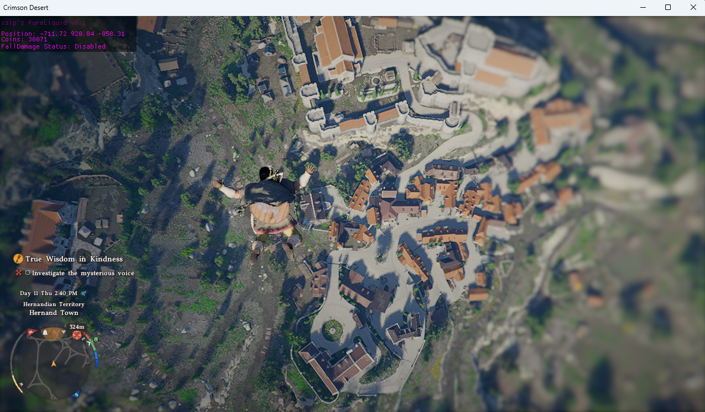

# Pure Liquid Crimson Desert External

## Features
1. No Fall Damage
2. Unlimited Coins ( Need to trade once or give a beggar coins to update coins)
```c++
 // Activate this block: CrimsonDesert::UIGamePlayControlCommonCurrencyIndicator::GetInstance()->m_iCoins = 999000; // Give 1 coin to a beggar or trade to update coins
```
3. Coordinates in UI.
4. Unlimited height jump ( Press mousewheel ( Mouse 4) )





## Dependencies

- [LiquidHookEx](https://github.com/xsip/LiquidHookEx) — external hooking library, pulled in as a git submodule.
- Windows, MSVC (v145 toolset), C++20.

## Building

```bash
git clone --recurse-submodules git@github.com:xsip/PureLiquid-Crimson-Desert-External.git
```

Open `CrimsonDesert-Developer-Console-Enabler.slnx` in Visual Studio, pick `Release|x64` - Debug wont work - and build.

If you already cloned without `--recurse-submodules`:

```bash
git submodule update --init --recursive
```

## Usage  
Join game and afterwards launch exe. Hooks will be applied. Press ```DEL``` to unload.