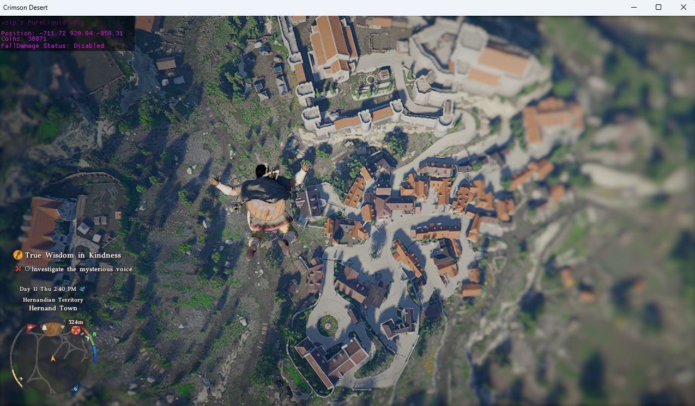

# Pure Liquid Crimson Desert External

## Features
1. No Fall Damage
2. Unlimited Coins ( Need to trade once or give a beggar coins to update coins)
```c++
 // Activate this block: CrimsonDesert::UIGamePlayControlCommonCurrencyIndicator::GetInstance()->m_iCoins = 999000; // Give 1 coin to a beggar or trade to update coins
```
3. Coordinates in UI.
4. Unlimited height jump ( Press mousewheel ( Mouse 4) )





## Dependencies

- [LiquidHookEx](https://github.com/xsip/LiquidHookEx) — external hooking library, pulled in as a git submodule.
- [ImGui](https://github.com/ocornut/imgui) — Rendering library, pulled in as a git submodule.
- Windows, MSVC (v145 toolset), C++20.

## Building

```bash
git clone --recurse-submodules git@github.com:xsip/PureLiquid-Crimson-Desert-External.git
```

Open `CrimsonDesert-Developer-Console-Enabler.slnx` in Visual Studio, pick `Release|x64` - Debug wont work - and build.

If you already cloned without `--recurse-submodules`:

```bash
git submodule update --init --recursive
```

## Usage  
Join game and afterwards launch exe. Hooks will be applied. Press ```DEL``` to unload.

## Manager discovery and generation

`ManagerLoopDumper` (declared in `CrimsonDesert/Structures/ManagerLoopDumper.h`) discovers manager singletons in the running game. Manager loop functions share a common code pattern, so the dumper scans for that pattern, follows its RIP-relative reference to the global instance, and uses the instance's MSVC RTTI to identify its class. This lets it find manager types and their singleton offsets without maintaining a separate signature for each manager.

The API provides three operations:

- `Dump()` prints each discovered manager class, its loop function address, and the singleton offset to the console.
- `Generate(false)` creates a header for each unique manager, along with `Offsets.h` and `Include.h`. The generated `GetInstance()` methods use `GetOffsetFor()` to resolve offsets at runtime.
- `Generate(true)` creates the same headers but embeds the discovered offsets as constants and includes the generated offsets header.
- `GetOffsetFor("ManagerClassName")` lazily collects manager offsets on its first call and returns the requested offset, or `0` when the class was not found.

To generate manager headers, call `Generate()` after the process and module handles have been initialized (as they are in `External/Main.cpp`):

```cpp
CrimsonDesert::ManagerLoopDumper::Generate(); // defaults to runtime offset lookup
// CrimsonDesert::ManagerLoopDumper::Generate(true); // embed offsets in generated headers
```

The files are written to `GENERATED_MANAGERS_DIR`. Ensure that directory exists and is writable before generating. The scan depends on the manager-loop byte pattern and the executable's MSVC RTTI layout, so findings depend on a compatible game build and available RTTI.
